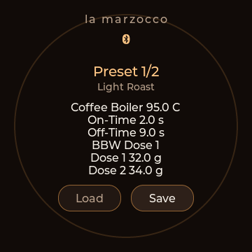

# Controller BLE scale adapter

The ESP32 controller connects to a physical BLE scale and presents a virtual
`LUNAR-C` scale to the machine. After selecting a scale once, the controller
handles its connection and reconnects when the scale wakes up. A phone or Mac
does not need to run the adapter.

The legacy Mini-USB Acaia Lunar has passed a connection and measurement smoke
test. BOOKOO Mini/Ultra support is experimental and has only synthetic host
tests; follow the separate [BOOKOO beta guide](BOOKOO_BETA_TEST.md). Newer Acaia
transports and other brands need their own drivers.

## Building and updating

Use the [flashing guide](FLASHING_CONTROLLER.md) for the supported round
ESP32-S3 board. This adapter build was verified with ESP-IDF **5.5.4**.
Fresh configurations inherit these settings from `sdkconfig.defaults`:

```ini
CONFIG_BT_NIMBLE_ROLE_BROADCASTER=y
CONFIG_BT_NIMBLE_ROLE_PERIPHERAL=y
CONFIG_BT_NIMBLE_MAX_CONNECTIONS=3
CONFIG_BT_NIMBLE_MEM_ALLOC_MODE_EXTERNAL=y
```

If the checkout already has a generated `firmware/esp32/sdkconfig`, use
`idf.py menuconfig` from that directory to enable peripheral and broadcaster
roles, allow three connections and select external RAM for NimBLE allocation.
Existing generated settings take precedence over defaults. Keep the three
**LVGL registry compatibility** options disabled for this project's LVGL 8.

Build from the repository root after loading your ESP-IDF environment:

```sh
./firmware/esp32/dev.sh build
./firmware/esp32/dev.sh test
```

For an existing installation with the current partition layout:

```sh
cd firmware/esp32
./dev.sh quick
```

`quick` updates the app and opens the serial monitor. Exit with `Ctrl+]`.
Use `./dev.sh full` for the first installation or after partition-layout changes.
Normal firmware updates retain scale settings and presets. Network reset also
retains scale settings; factory reset erases them. Do not erase flash for a
normal adapter update.

## Select the Acaia once

1. Complete the controller's [network and machine setup](SETUP_GUIDE.md).
   Open its local portal at `http://<hostname>.local/` or its IP address and
   sign in if portal access is protected.
2. Turn on the Acaia in **Mode 2**, with the display using **grams**. Close
   Acaia/La Marzocco apps or other devices holding a direct BLE connection to
   the scale. Leave the machine switched on and its paddle off during setup.
3. Open **Scale Adapter**. Select **Acaia Lunar (legacy)**, check
   **Enable Scale Adapter**, leave **Source BLE Address** empty and save.
   The controller scans in short windows; reload the page after a few seconds.
4. Find the physical scale under **Observed Scales** and select its exact
   address in **Source BLE Address**. The selector copies its public/random
   address type; verify it against the observed entry. If necessary, enter
   the address and matching type manually. An observed name alone does not
   select or authorize a connection.
5. Keep **Virtual Scale Name** at `LUNAR-C`, confirm manual weight/timer mode
   with grams and press **Save Scale Adapter** again.
6. Reload the portal. Check **Source: fresh**, compare its weight with the
   scale display and wait for **Machine scale link: connected**. Initial
   registration can take longer than the source connection.

The address, driver, mode confirmation and virtual name are stored in encrypted
controller NVS. Later boots reconnect to that exact address. To change scales
or rescan, clear the source address, save, then repeat selection. Saving restarts
the adapter session, so perform configuration changes with the paddle off.

## Understand the two connections

The physical scale connects to the controller; the machine independently
connects to the controller's virtual scale. Both connections must work.

| Indicator | Meaning |
| --- | --- |
| Dimmed balance-scale header icon | The physical scale is connected; the machine scale link or fresh measurements are still pending. |
| Bright balance-scale header icon | Fresh physical-scale measurements and a subscribed machine scale link are both present. |
| No balance-scale header icon | The physical scale is disconnected, the adapter is disabled or a protocol fault stopped it. |
| `Source: connected, awaiting data` | BLE connected, but setup or the fresh measurement stream is incomplete. |
| `Source: fresh` | Validated measurements are at most one second old. |
| Machine link `advertising` | The virtual scale is available and waiting for the machine. |
| Machine link `connected` | The machine connected and subscribed to scale notifications. |
| Source / Machine sessions | Connection counts since controller boot; useful when testing recovery. |
| Registration requests | Position-registration requests sent since boot, including delivery failures; not successful calibrations. |

While the scale adapter is active, periodic machine status uses the cloud.
The controller releases its owner BLE link so the machine can connect back to
its virtual scale. Controls fall back to the cloud while that scale link is
established. A missing Bluetooth header icon can therefore be normal; inspect
the two scale statuses separately.

## Reconnection and controller placement

Wake the selected scale and leave the controller powered. A source disconnect
invalidates its old weight, stops virtual-scale advertising and closes the
machine scale session. A new source session must supply a validated handshake
and fresh weight before the virtual scale becomes available again.

There is no configured distance threshold for the source connection. BLE range
depends on placement and obstructions. For diagnosis, put the controller near
both devices, then test at its intended permanent position. The machine's
location training measures the **controller's** radio signal, so leave its
position and virtual name stable during registration and normal use.

If the machine link is absent while source data is fresh, the controller checks
the machine's registrations. It sends `SetScalePosition` with `force:false`
only when its registration is missing and no other scale is registered. Checks
retry with 30/60/120/240-second backoff. An existing registration is retained;
another scale, standby or an unreadable response prevents an automatic write.

A runtime entry or `calibrated:true` does not establish persisted location
calibration. Persistence after machine restart still needs a hardware test.

## Presets with dose targets

When the selected machine reports Brew by Weight support, recipe presets save
and restore the BBW mode (**Dose 1**, **Dose 2** or **Continuous**) and both dose
weights, alongside boiler temperature and prebrewing times.

Swipe down to open presets, select a slot with the ring, then use **Save** or
**Load**. On the German UI these buttons read **Sichern** and **Laden**. The
buttons follow the actual summary height with a constant gap, so the extra BBW
lines remain above them. Long preset names are shortened to one line.



## Connection debug log

To investigate intermittent failures over several days, open **Scale Adapter →
Connection Debug Log** and select **Start Connection Log**. This changes only
diagnostic capture; it does not change the selected scale, virtual name or
location calibration. Leave the controller powered in its normal position.
USB and a running computer are not required. Capture remains enabled after
restarts until you select **Stop Log**; stopping retains its existing records.

Select **Download Log** to obtain `scale-connection-log.txt`. Download after an
incident and note its approximate local time. The file uses UTC, sequence
numbers, a boot ID and monotonic uptime. The controller synchronizes its clock
through NTP when WLAN is available. Entries before that boot's first NTP sync
can receive an estimated UTC timestamp, marked `*`, using a same-boot anchor
in the ring (up to 64 boot anchors per export). Otherwise they retain
`UTC-unknown`, boot ID and uptime.

Capture includes startup/build identification, selected adapter configuration,
matching scale advertisements and their signal strength, connection results,
handshake/subscription status, registration attempts, disconnect reason codes
and failure context. For Acaia, rejected frames are captured after assembling
all BLE fragments, including header and checksum. `source-frame` records carry
an ID, kind, byte count, completeness and checksum flags; following records
contain hex chunks with byte offsets. Concatenate chunks with the same ID in
offset order. `complete=0` explicitly marks an incomplete framing prefix.
Unrecognized startup replies are also captured once per opcode/source session.

When a control is pending at shutdown, `control` records identify the requested
action and the current physical operation (for example, start versus its
preceding reset), transaction ID, elapsed time, timeout, dispatch/ACK flags,
ACK delay and post-command sample count. Last-ACK metadata includes its age,
matching status, normalized operation and raw ID/code. The encoded source write
and last assembled ACK frame are included when available. A dispatch attempt
is not proof of over-air delivery or execution; unknown ACKs never confirm a
control. The Acaia 450 ms control timeout is unchanged in this diagnostic build.

There is no continuous weight recording, normal tare/timer trace, global
serial-log interception or account/token payload capture. A full failure-context
ACK frame may contain an embedded measurement.

The last 1 MiB of the existing `storage` partition is reserved for the raw
diagnostic journal. It holds up to 4,080 CRC-protected records; the oldest sector
is reclaimed when full. Retention depends on event frequency, not a fixed
number of days. Capture is limited to 60 queued events per minute, with a
bounded RAM queue and overload counters. Flash writes run in a background task.
An interrupted record is ignored after restart; the final queued events may be
lost on abrupt power removal. Existing nonblank data without the journal's
header is preserved and prevents initialization.

**Clear Log** stops capture and erases the recognized journal. Factory reset
also clears it. A normal app update or network reset retains the log and its
capture setting. Downloads and controls follow the normal portal access rules;
authenticated sessions require CSRF for state changes and clearing. The journal
is diagnostic plaintext in flash, not encrypted account storage; downloads can contain scale
identifiers and rejected protocol bytes, so inspect them before sharing.

## Troubleshooting

| Status or symptom | Action |
| --- | --- |
| `Scale adapter disabled` | Enable and save the adapter in the portal. |
| No observed scales | Wake the scale, close connected apps, clear the source address, enable and save, then reload. Check driver/model and proximity. Discovery lists known name prefixes; manual address entry remains available. |
| Repeated setup timeout | Verify the selected address and public/random type, the legacy Acaia transport, Mode 2 and grams. |
| Fresh source, machine still waiting | Turn the machine on, check its selected binding and registration status, and allow the retry backoff. Another scale's registration must be resolved before automatic registration can proceed. |
| Source settings do not report grams / source protocol rejection | Verify the physical display uses grams and the correct driver is selected, then save the settings again. Enable the connection debug log before retrying and download its full rejected frame after a recurrence; USB `lm_scale` logs are another option. |
| Control confirmation timeout | Check physical mode and whether tare/timer actually responded. Correct the setup, then save again to clear the fault. |
| Dimmed icon and machine link absent | The scale is connected to the controller. Check its fresh-data status and the machine registration status in the portal. |

Protocol/control faults stop the adapter until settings are saved again. The
hardware debug session also observed an intermittent Acaia protocol
fault while the display showed grams; the rejected packet was not captured.
The later log captured the repeated body/checksum `070214023c14005718` during
initialization, but not its complete header. The parser now tolerates validated
ancillary replies and unrecognized startup layouts while waiting for a known
gram handshake and fresh weight. These replies do not establish readiness or
acknowledge controls. Supported seven-/nine-byte settings require the explicit
gram unit and a valid battery; unknown settings after a gram handshake still
stop the adapter. Bad checksums and malformed known records remain errors.
The exact header/meaning of the captured startup body still needs confirmation
from the next hardware run; tests use explicitly reconstructed header variants.

For a report, include controller revision, scale model/firmware/mode, machine
model/firmware, both link statuses, session counts and relevant `lm_scale` USB
lines. Keep account credentials, machine tokens, raw account exports and flash
backups private.

## Validation and remaining hardware checks

The 2026-10-26 controller smoke test matched a displayed **2.9 g** to received
values around **2.89–2.91 g**. The machine independently reported `LUNAR-C`
connected, the source battery and BBW availability. One scale off/on cycle
restored both links without another position request. The revised preset layout
was flashed and visually accepted on 2026-10-27.

On 2026-10-29, hardware checks verified persistent diagnostic capture across
three boot sessions, NTP synchronization, readable log downloads and estimated
UTC timestamps for events before synchronization. Capture remained enabled
after restart. Renderer checks cover dimmed/source and bright/machine icon states.

To repeat the connection test, leave the paddle off, check zero and an object
on the scale, power the scale off for about five seconds, then on. Confirm the
icon disappears and returns, both links recover, and the received weight matches.
Repeat separately after a controller restart and a machine restart; record the
registration counters and position-calibration behavior.

Physical tare/timer translation, repeated recovery, machine-restart calibration
persistence and automatic weight-stop precision still need controller hardware
validation. A water-only brew test should be supervised and stopped manually
if the machine does not stop at its target. The adapter sends scale operations;
it does not issue pump or valve commands.

## Extending the driver layer

Implement the `scale_driver.h` contract for a new BLE protocol and register it
in `scale_drivers.c`, the portal selector and the build. Drivers emit normalized
gram weights, battery/readiness and control completions. ATT write acceptance
alone must not confirm tare/timer execution. Keep protocol callbacks on the
shared NimBLE queue and add host fixtures for malformed data, fragmentation,
commands and completion timing. A driver also needs its own hardware validation;
selecting an arbitrary BLE device does not make its protocol compatible.
