# Controller Screenshot Gallery

These screenshots are stored as PNG files in `docs/controller/images/` so they render reliably on GitHub and can be reused in issues, release notes, and documentation.
Regenerate the device shots and portal preview with `make -C tools/controller_screenshot_renderer export` after UI or portal changes.

The published screenshots intentionally show the shipped text header and not an official La Marzocco logo.

## Main control screens

| Coffee Boiler | Prebrewing On-Time | Prebrewing Off-Time |
| --- | --- | --- |
| 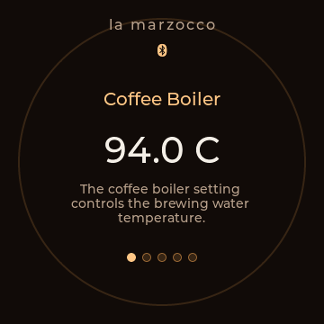 | 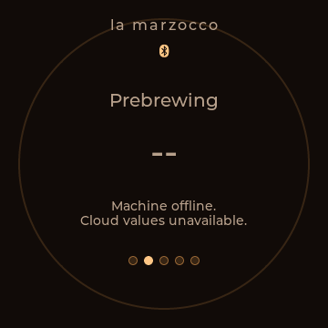 | 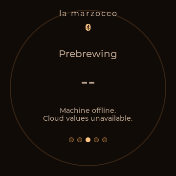 |

| Steam Boiler | Status | Preset View |
| --- | --- | --- |
| 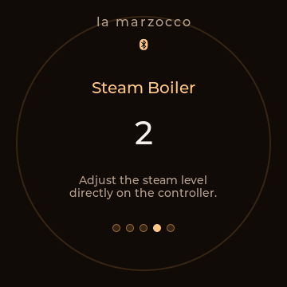 | 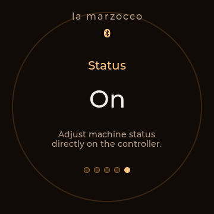 | 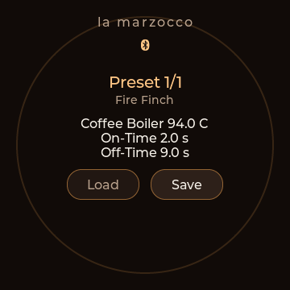 |

## Presets with Brew by Weight

Load/Save follow the summary height so BBW mode and both dose targets remain
above the buttons. The renderer checks text separation, translated button
labels and touch targets against the round display boundary in both languages.
Published screenshots use English.

## Scale connection states

The scale icon is dimmed for a physical-scale connection and fully bright only
with fresh readings and a subscribed machine scale link. The separate owner BLE
icon is independent. These examples leave the ordinary machine controls offline
to show that distinction.

| Physical scale connected | Fresh scale and machine link |
| --- | --- |
| 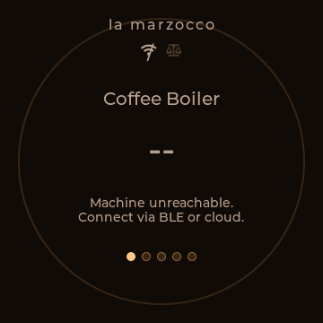 | 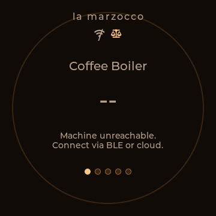 |

## Setup screens

| First setup AP | Setup with Wi-Fi connected |
| --- | --- |
| 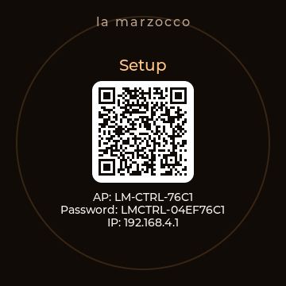 | 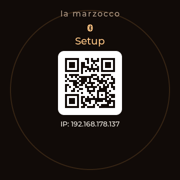 |

## Local setup portal

This screenshot is generated locally from `tools/controller_screenshot_renderer/controller_setup_portal_preview.html`, a preview page that mirrors the setup portal structure and styling with representative example values. The preview includes `Overview`, `Controller`, `Network`, `Cloud`, `Recipes`, `Scale Adapter`, `Advanced`, and `Diagnostics` while keeping the shipped header text-only. It is a static example; use the live portal to operate the controller.

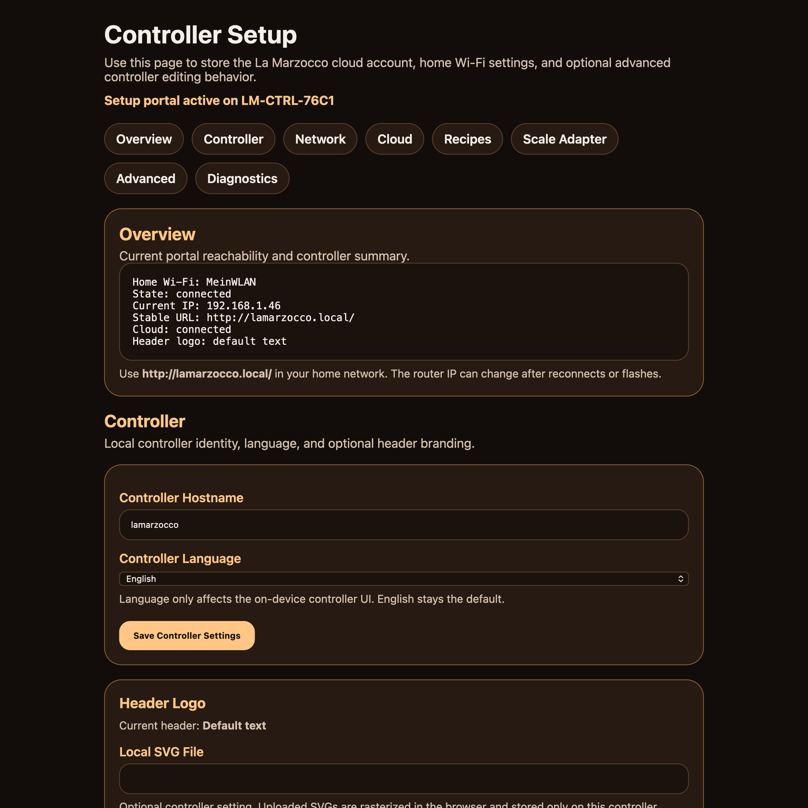

## Notes

- UI screenshots for the round controller belong in `docs/controller/images/` because they are part of the controller-specific documentation.
- Released screenshots should keep vendor compatibility as text and avoid official logo branding in the published images.
- The current main-screen examples intentionally show BLE-authenticated fallback with a crossed Wi-Fi icon. A solid Wi-Fi icon is only shown once the selected machine is reachable through cloud.
- USB and battery icons are conditional runtime indicators, so they only appear in screenshots when the rendered sample state exposes them.
